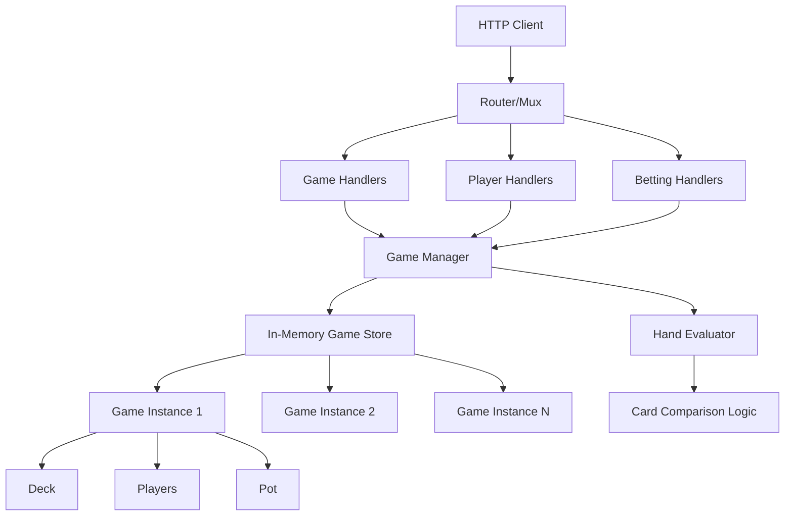

# REST Poker Server Implementation Plan

## Overview

Transform the current basic deck management system into a full-featured REST poker server supporting Texas Hold'em with multiple concurrent games. The server will manage game lifecycle, player actions (call, raise, fold), betting rounds, hand evaluation, and game state.

## Architecture



## Implementation Phases

### Phase 1: Game State Management

**Files to create/modify:**

1. **[core/gamestate.go](core/gamestate.go)** - New file
   - `Hand` struct (pre-flop, flop, turn, river)
   - `BettingRound` enum (PRE_FLOP, FLOP, TURN, RIVER, SHOWDOWN)
   - `GameState` struct with:
     - Current betting round
     - Community cards
     - Pot amount
     - Current bet amount
     - Last action player index
     - Button position
     - Small blind position
     - Big blind position
     - Active players count

2. **[core/gamelogic.go](core/gamelogic.go)** - Extend existing
   - Implement `Game.newGame()` method
   - Add `Game.Start()` method
   - Add `Game.AddPlayer()` method
   - Add `Game.RemovePlayer()` method
   - Add `Game.GetState()` method
   - Add `Game.AdvanceBettingRound()` method
   - Add button/blind rotation logic
   - Add minimum 2 players validation

3. **[core/gamestore.go](core/gamestore.go)** - New file
   - `GameStore` struct (map[string]*Game)
   - `CreateGame()` - generates unique game ID
   - `GetGame(gameID string)` - retrieve game
   - `ListGames()` - list all active games
   - `DeleteGame(gameID string)` - cleanup
   - Thread-safe operations (mutex)

### Phase 2: Player Management

**Files to modify:**

1. **[core/gamelogic.go](core/gamelogic.go)**
   - Enhance `Player` struct:
     - Add `Chips` field (current chips)
     - Add `CurrentBet` field (bet in current round)
     - Add `Position` field (seat position)
     - Add `Hand` field (player's hole cards)
   - Add `Player.JoinGame()` method
   - Add `Player.LeaveGame()` method
   - Add `Player.IsAllIn()` method
   - Add `Player.CanAct()` method

2. **[core/rest.go](core/rest.go)** - Extend existing
   - `CreatePlayer()` handler - POST `/api/poker/players`
   - `GetPlayer()` handler - GET `/api/poker/players/{playerID}`
   - `JoinGame()` handler - POST `/api/poker/games/{gameID}/players`
   - `LeaveGame()` handler - DELETE `/api/poker/games/{gameID}/players/{playerID}`

### Phase 3: Betting System

**Files to create/modify:**

1. **[core/betting.go](core/betting.go)** - New file
   - `BetAction` struct (Call, Raise, Fold, Check)
   - `BettingRound` management
   - `ProcessBet()` method - validates and processes bets
   - `CalculatePot()` method - sum all bets
   - `IsBettingRoundComplete()` method - check if all players acted
   - `GetNextPlayer()` method - determine whose turn it is
   - `CollectBets()` method - move bets to pot
   - Side pot calculation for all-in scenarios

2. **[core/gamelogic.go](core/gamelogic.go)**
   - Implement `Player.call()` method (currently empty)
   - Add `Player.raise(amount float64)` method
   - Add `Player.fold()` method
   - Add `Player.check()` method
   - Add bet validation (sufficient chips, valid action)

3. **[core/rest.go](core/rest.go)**
   - `PlayerAction()` handler - POST `/api/poker/games/{gameID}/actions`
   - Request body: `{ "playerID": "...", "action": "call|raise|fold|check", "amount": 0 }`
   - Validate action based on game state
   - Return updated game state

### Phase 4: Hand Evaluation

**Files to create:**

1. **[core/handevaluator.go](core/handevaluator.go)** - New file
   - `EvaluateHand()` function - evaluates best 5-card hand from 7 cards
   - `HandRank` enum (HIGH_CARD, PAIR, TWO_PAIR, THREE_KIND, STRAIGHT, FLUSH, FULL_HOUSE, FOUR_KIND, STRAIGHT_FLUSH, ROYAL_FLUSH)
   - `CompareHands()` function - compares two hands
   - `GetBestHand()` function - finds best hand from hole + community cards
   - `DetermineWinner()` function - determines winner(s) from active players
   - Card combination logic for each hand type

### Phase 5: Game Flow Management

**Files to modify:**

1. **[core/gamelogic.go](core/gamelogic.go)**
   - `Game.DealHoleCards()` - deal 2 cards to each player
   - `Game.DealFlop()` - deal 3 community cards
   - `Game.DealTurn()` - deal 1 community card
   - `Game.DealRiver()` - deal final community card
   - `Game.EndHand()` - evaluate hands, distribute pot, rotate button
   - `Game.StartNewHand()` - reset for new hand
   - Implement full Texas Hold'em hand flow

2. **[core/gamestate.go](core/gamestate.go)**
   - Add `HandHistory` struct for logging
   - Track all actions in current hand
   - Store previous hand results

### Phase 6: REST API Endpoints

**Files to modify:**

1. **[core/rest.go](core/rest.go)** - Major expansion
   - Standardize response format (JSON wrapper)
   - Add error response helpers
   - Implement all endpoints:
     - `POST /api/poker/games` - Create new game
     - `GET /api/poker/games` - List all games
     - `GET /api/poker/games/{gameID}` - Get game state
     - `POST /api/poker/games/{gameID}/start` - Start game
     - `POST /api/poker/games/{gameID}/actions` - Player action
     - `GET /api/poker/games/{gameID}/players` - List players in game
     - `POST /api/poker/games/{gameID}/players` - Join game
     - `DELETE /api/poker/games/{gameID}/players/{playerID}` - Leave game
     - `GET /api/poker/deck/dealer` - Keep existing endpoint

2. **[infra/webserver.go](infra/webserver.go)** - Refactor
   - Replace manual route registration with router
   - Use `gorilla/mux` or `chi` router
   - Add middleware:
     - Request logging
     - CORS headers
     - JSON content-type validation
   - Centralized error handling
   - Route grouping (`/api/poker/*`)

3. **[core/response.go](core/response.go)** - New file
   - `Response` struct wrapper
   - `ErrorResponse` struct
   - Helper functions: `SuccessResponse()`, `ErrorResponse()`
   - Standardize all API responses

### Phase 7: Request/Response Models

**Files to create:**

1. **[core/models.go](core/models.go)** - New file
   - Request DTOs:
     - `CreateGameRequest`
     - `JoinGameRequest`
     - `PlayerActionRequest`
   - Response DTOs:
     - `GameResponse`
     - `PlayerResponse`
     - `GameStateResponse`
   - JSON tags for all structs
   - Validation helpers

### Phase 8: Error Handling & Validation

**Files to create:**

1. **[core/errors.go](core/errors.go)** - New file
   - Custom error types:
     - `GameNotFoundError`
     - `PlayerNotFoundError`
     - `InvalidActionError`
     - `InsufficientChipsError`
     - `NotPlayerTurnError`
     - `GameNotStartedError`
   - Error codes and messages
   - HTTP status code mapping

2. **[core/validation.go](core/validation.go)** - New file
   - Validate game state transitions
   - Validate player actions
   - Validate bet amounts
   - Validate player positions

### Phase 9: Testing

**Files to create/modify:**

1. **[core/gamestate_test.go](core/gamestate_test.go)** - New file
   - Test game state transitions
   - Test betting round progression

2. **[core/betting_test.go](core/betting_test.go)** - New file
   - Test bet processing
   - Test pot calculation
   - Test side pots

3. **[core/handevaluator_test.go](core/handevaluator_test.go)** - New file
   - Test all hand types
   - Test hand comparisons
   - Test winner determination

4. **[core/rest_test.go](core/rest_test.go)** - New file
   - Integration tests for all endpoints
   - Test error cases
   - Test request validation

### Phase 10: Configuration & Improvements

**Files to create/modify:**

1. **[core/config.go](core/config.go)** - New file
   - Default blind values
   - Max players per game
   - Time limits
   - Configurable via environment variables

2. **[infra/webserver.go](infra/webserver.go)**
   - Make port configurable
   - Add graceful shutdown
   - Add health check endpoint

3. **[core/gamelogic.go](core/gamelogic.go)**
   - Fix `Deck.Init()` to clear existing cards (bug fix)
   - Improve shuffle algorithm
   - Add deck reset functionality

## Key Implementation Details

### Game State Machine
```
CREATED -> WAITING_PLAYERS -> STARTING -> PRE_FLOP -> FLOP -> TURN -> RIVER -> SHOWDOWN -> ENDED
```

### Betting Round Flow
1. Deal hole cards (PRE_FLOP)
2. Small blind posts
3. Big blind posts
4. Betting round (starting from UTG)
5. Deal community cards (FLOP/TURN/RIVER)
6. Repeat betting rounds
7. Showdown
8. Distribute pot
9. Rotate button/blinds

### Data Structures

```go
type Game struct {
    ID              string
    State           GameState
    Players         []Player
    Deck            Deck
    CommunityCards  []Card
    Pot             float64
    CurrentBet      float64
    ButtonPosition  int
    BettingRound    BettingRound
    EventManager    EventManager
    CreatedAt       time.Time
    UpdatedAt       time.Time
}
```

## Dependencies to Add

- `github.com/gorilla/mux` or `github.com/go-chi/chi` - Router
- `github.com/google/uuid` - Game/Player ID generation

## API Endpoint Summary

| Method | Endpoint | Description |
|--------|----------|-------------|
| POST | `/api/poker/games` | Create new game |
| GET | `/api/poker/games` | List all games |
| GET | `/api/poker/games/{gameID}` | Get game state |
| POST | `/api/poker/games/{gameID}/start` | Start game |
| POST | `/api/poker/games/{gameID}/players` | Join game |
| DELETE | `/api/poker/games/{gameID}/players/{playerID}` | Leave game |
| GET | `/api/poker/games/{gameID}/players` | List players |
| POST | `/api/poker/games/{gameID}/actions` | Player action (call/raise/fold/check) |
| GET | `/api/poker/deck/dealer` | Deal cards (existing) |

## Success Criteria

- Multiple concurrent games supported
- Full Texas Hold'em hand flow implemented
- All player actions (call, raise, fold, check) working
- Hand evaluation and winner determination
- Proper error handling and validation
- Comprehensive test coverage
- Clean REST API with consistent responses
- Thread-safe game store operations

## Implementation Checklist

- [ ] Phase 1: Game State Management
  - [ ] Create `core/gamestate.go` with Hand, BettingRound, GameState structs
  - [ ] Create `core/gamestore.go` with thread-safe game store
  - [ ] Extend `core/gamelogic.go` with Game methods

- [ ] Phase 2: Player Management
  - [ ] Enhance Player struct in `core/gamelogic.go`
  - [ ] Add player REST endpoints in `core/rest.go`

- [ ] Phase 3: Betting System
  - [ ] Create `core/betting.go` with betting logic
  - [ ] Implement player action methods
  - [ ] Add betting REST endpoint

- [ ] Phase 4: Hand Evaluation
  - [ ] Create `core/handevaluator.go` with hand evaluation logic

- [ ] Phase 5: Game Flow Management
  - [ ] Implement full Texas Hold'em hand flow
  - [ ] Add hand history tracking

- [ ] Phase 6: REST API Endpoints
  - [ ] Implement all game management endpoints
  - [ ] Refactor `infra/webserver.go` with router
  - [ ] Create `core/response.go` for standardized responses

- [ ] Phase 7: Request/Response Models
  - [ ] Create `core/models.go` with DTOs

- [ ] Phase 8: Error Handling & Validation
  - [ ] Create `core/errors.go` with custom error types
  - [ ] Create `core/validation.go` with validation logic

- [ ] Phase 9: Testing
  - [ ] Create comprehensive test files for all components

- [ ] Phase 10: Configuration & Improvements
  - [ ] Create `core/config.go` for configuration
  - [ ] Add graceful shutdown and health check
  - [ ] Fix deck initialization bug
